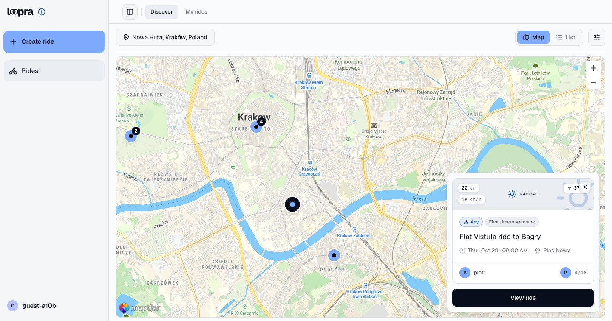
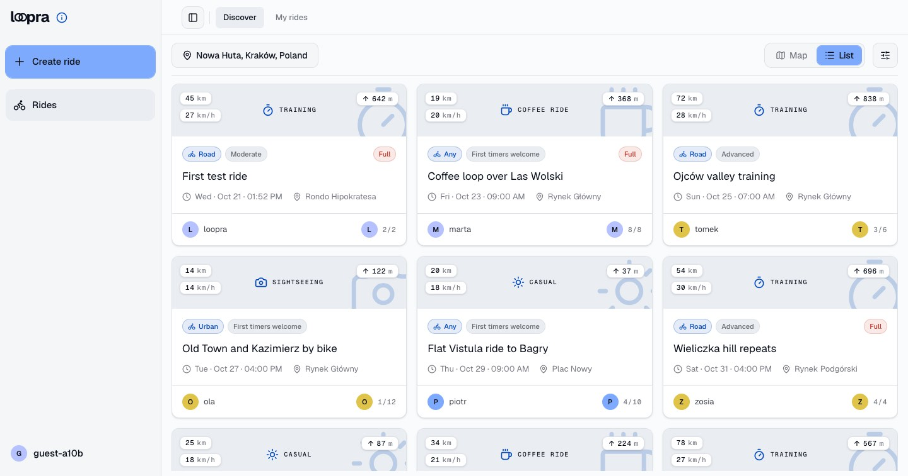
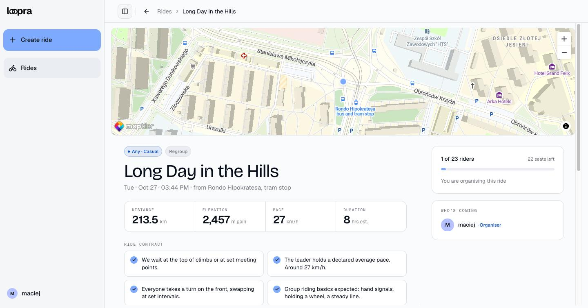
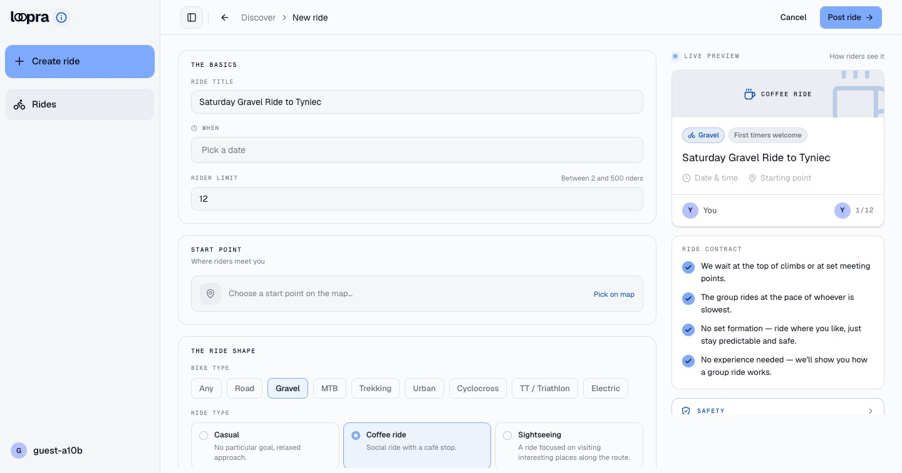

# Loopra

[](https://github.com/MMaciej0/loopra/actions/workflows/ci.yml)

Loopra is a platform for cyclists. A rider creates a ride, other riders join it, and everyone can find rides near them on a map.

Strava is good at tracking a ride. Facebook groups are good at talking. Neither is good at the question "who can I ride with this Saturday?". Loopra is built to answer that question.

**Try it:** [staging.loopra.cc](https://staging.loopra.cc). Click **Use a guest account** on the login page — no email, no password. The demo Rides are around Kraków.

> **Status:** work in progress. The API and the website work and run on a staging server. Production is prepared but not launched yet. The mobile app is planned.

## Contents

- [Screenshots](#screenshots)
- [Features](#features)
- [Tech stack](#tech-stack)
- [Architecture](#architecture)
- How it is built, and why
  - [Authentication](#authentication)
  - [Rides](#rides)
  - [Routes](#routes)
  - [Across the whole project](#across-the-whole-project)
- [Running locally](#running-locally)
- [Testing and CI](#testing-and-ci)
- [Deployment](#deployment)
- [Roadmap](#roadmap)
- [More documentation](#more-documentation)
- [License](#license)

## Screenshots

**Rides on a map.** The map loads the rides for the area you are looking at.



**Rides as a list.** The same rides, ordered by start time, with filters.



**Ride page.** The route on the map, the stats, the ride contract and the join card.



**Create a ride.** The preview on the right changes while you type.



## Features

What works today:

- **Accounts** — register with email and password, or log in with Google. Email verification and password reset by email.
- **Rides** — create a ride with a start point on a map, a date, a bike type, a ride type and a maximum number of riders.
- **Ride contract** — the organiser says how the group will ride: who waits for slow riders, who sets the pace, how the group rides on the road, and what experience is expected.
- **Find rides** — a list of rides near your location, and a map that loads rides for the area you are looking at.
- **Join and leave** — a ride has a real headcount. A full ride cannot be joined.
- **Routes** — upload a GPX file. The API calculates distance, ascent, descent and an elevation profile. The ride page draws the route on the map.
- **Locations** — save up to five favourite locations and pick one as the start for your search.
- **Contact** — a contact form for bug reports, sent by email.
- **Guest accounts** — on staging only, one click creates an account with no email and no password, so anyone can try Loopra.
- **Two languages** — English and Polish. Light and dark theme.

## Tech stack

| Layer      | Technology                       | Why                                                         |
| ---------- | -------------------------------- | ----------------------------------------------------------- |
| Monorepo   | pnpm workspaces                  | API and web share one package with types and rules          |
| API        | Fastify + TypeScript             | Fast, and every feature is a small plugin                   |
| Database   | PostgreSQL + PostGIS             | PostGIS answers "which rides are in this area?" in SQL      |
| ORM        | Drizzle ORM                      | The schema is TypeScript code, and migrations are plain SQL |
| Cache      | Redis                            | Stores refresh tokens and rate limit counters               |
| Auth       | JWT access token + refresh token | Short-lived access token, long-lived refresh token          |
| Storage    | S3-compatible storage            | Keeps the uploaded GPX files                                |
| Validation | Zod                              | See [Across the whole project](#across-the-whole-project)   |
| Web        | Next.js (App Router) + React 19  | Server Components and Server Actions                        |
| UI         | Tailwind CSS + shadcn/ui         | Accessible components that I own and can change             |
| Maps       | MapLibre + MapTiler              | Map display and place search                                |
| Tests      | Vitest                           | Runs against a real Postgres, not a mock                    |
| CI and CD  | GitHub Actions                   | Checks on every push, deploys with one click                |
| Hosting    | Docker Compose on one VPS        | Cheap, and staging runs the same image as production        |
| Edge       | Nginx + Let's Encrypt (certbot)  | One entry point with HTTPS for all environments             |
| Images     | GitHub Container Registry (GHCR) | One image per commit, reused from staging to production     |

## Architecture

```
apps/
  api/        Fastify REST API. The core of the project.
  web/        Next.js website.
packages/
  domain/     The shared contract: enums, limits, error codes, response types and schemas.
  gpx/        GPX parsing, elevation profile, simplified path for the map.
docs/         Design documents and decision records.
```

How one request travels:

1. The browser calls a **Server Action** in `apps/web`.
2. The Server Action calls the **API** with the rider's JWT.
3. A **route** in the API declares Zod schemas. Fastify validates the input with them, and the route calls a **service**.
4. The service talks to PostgreSQL through Drizzle and returns a row.
5. A **response schema** from `packages/domain` decides which fields leave the API.

The API is split into modules (`auth`, `users`, `rides`, `routes`, `contact`, `health`). Every module has the same shape: `routes.ts`, `errors.ts`, a `schema.ts` when the module has request schemas only the API uses, and a `services/` folder with one file per operation. Services do not import Fastify, so they are easy to test and reuse.

## Authentication

A rider logs in with email and password, or with Google. Two tokens keep the rider logged in, and both live in `httpOnly` cookies.

| Token         | What it is                    | Lifetime   | Where it is stored                            |
| ------------- | ----------------------------- | ---------- | --------------------------------------------- |
| Access token  | A signed JWT with the user id | 15 minutes | Only in the cookie                            |
| Refresh token | A random 32-byte value        | 30 days    | In the cookie, and as a SHA-256 hash in Redis |

The main decisions:

- **Refresh tokens live in Redis**, so a session can be cancelled. Logout deletes one token family, and a password change deletes all of them.
- **Every refresh rotates the refresh token.** If a replaced token is used again, all sessions of the user are closed. A 10-second reuse window lets two tabs refresh at the same moment ([ADR-0004](docs/adr/0004-replaced-refresh-token-has-a-reuse-window.md)).
- **Tokens are `httpOnly` cookies**, so a script on the page cannot read them. The price: every API call goes through the Next.js server.
- **Login gives one answer for every failure**, so nobody can test which emails have accounts.
- **Unverified accounts are disposable** when the real owner logs in with Google ([ADR-0002](docs/adr/0002-unverified-account-is-disposable.md)).

Known limits: a copied access token works until it expires (at most 15 minutes), and a refresh response that never reaches the browser logs the rider out.

The full reasons, the flow step by step, and all known limits are in [`docs/authentication.md`](docs/authentication.md).

## Rides

An organiser creates a ride with a start point, a time, a Capacity (the maximum number of riders) and a ride contract. Other riders find it on a list or on a map, and join it.

A ride stores only what the organiser decided. Facts that change by themselves are calculated when they are needed:

| Value        | Values                            | Where it comes from                       |
| ------------ | --------------------------------- | ----------------------------------------- |
| Ride Status  | `draft`, `published`, `cancelled` | Stored. Only the organiser changes it.    |
| Availability | `open`, `full`                    | Calculated from Capacity and participants |
| Phase        | `upcoming`, `past`                | Calculated from the start time and clock  |

The main decisions:

- **Availability and Phase are never stored**, so they can never be out of date. One pure function for each lives in `packages/domain`, and the API and the web both call it ([ADR-0003](docs/adr/0003-availability-and-phase-are-derived.md)).
- **Two riders cannot take the last seat.** Join locks the ride row (`SELECT ... FOR UPDATE`) in a transaction, so the second request waits and then sees a full ride.
- **The organiser holds a seat.** Creating a ride also adds the organiser as a participant, so no count needs a special case. The organiser cannot leave, only cancel.
- **Cancel, never delete.** A cancelled ride keeps its participants, so they can see what happened. Cancel is final.
- **A ride needs 5 hours of lead time**, so nobody creates a ride that no one can find in time.
- **A stranger gets `404`, not `403`**, when they try to change or cancel a ride that is not theirs.
- **Map search uses PostGIS.** The map sends its visible box (`bbox`), and the `&&` operator uses a **GiST index** (an index made for geometry). The box is at most 100 km, so nobody can ask for the whole world.
- **The map loads points first, cards later.** It gets only id and coordinates for each ride, and loads full cards when the rider clicks a marker.
- **The list uses a cursor**, not page numbers, so a new ride never makes the rider see one ride twice.

Known limits: an organiser can lower Capacity below the number of riders who already joined, and a past ride can still be edited. Nothing happens at the moment a ride ends, because nothing writes to it. Private rides wait for an alert or messaging system, because the organiser needs a way to invite riders.

The full reasons, the flow step by step, and all known limits are in [`docs/rides.md`](docs/rides.md).

## Routes

A route is the path of a ride, uploaded as a GPX file.

**Why routes matter.** A start point and a time are not enough to decide if a ride is right for you. The route shows where the group goes, how far, and how much it climbs. A rider can see before joining whether 80 km with 1,200 m of climbing fits their legs.

**What works today:**

- **Upload when creating a ride.** The organiser drops a GPX file on the create-ride form. The form shows the elevation profile at once and fills in the distance.
- **View on the ride page.** The ride page draws the route on the map and shows its elevation profile, distance, ascent and descent.
- **Download from the ride page.** After joining a ride, a button on the ride map downloads the original GPX file, so riders can follow the route on their bike computer. The file comes straight from storage through a short-lived signed link.

**How a route is stored.** One upload is kept in two places:

| What                                                          | Where                 | Why                                                                    |
| ------------------------------------------------------------- | --------------------- | ---------------------------------------------------------------------- |
| The original GPX file                                         | S3-compatible storage | It has every point. It is kept for download and for future features.   |
| Distance, ascent, descent, elevation profile, simplified path | PostgreSQL (`routes`) | Small, ready data for the map and the chart. The browser needs no GPX. |

The API parses the file once, at upload, with the `@loopra/gpx` package, and stores the results. Nothing parses GPX again when a page loads. If the database insert fails after the file upload, the API deletes the file, so no file is left without a row.

For now routes live only inside rides. They will become their own feature, with a list of your routes and reuse across rides, after the rides core is finished.

How the parser works, the storage decisions, and the known limits are in [`docs/routes.md`](docs/routes.md).

## Across the whole project

These decisions do not belong to one feature.

### One shared contract for API and web

**Problem:** the API and the website must agree on many things: the list of bike types, the maximum ride size, the error codes. If each app keeps its own copy, the copies drift apart.

**Decision:** everything both sides must agree on lives in `packages/domain`, and nowhere else. The package has two entry points. `@loopra/domain` has only types and constants. `@loopra/domain/schemas` has the Zod schemas. The API validates and serializes with them, and the web parses each reply with the same schema. Dates travel as ISO strings and are `Date` on both sides. Zod is the only schema library ([ADR-0005](docs/adr/0005-zod-is-the-only-schema-library.md)).

### A response schema on every endpoint

**Problem:** handlers send database rows straight to the client. A row from the `users` table includes `password_hash`.

**Decision:** every route declares a response schema. Fastify uses it to serialize the reply, and any field that is not in the schema is removed. The tests check the exact list of keys in each reply, so a leak fails a test.

### No race condition on a unique value

A **race condition** is a bug where two requests arrive at the same time and the result depends on which one is first.

**Problem:** the usual way to check a taken email is "`select`, and if nothing is found, `insert`". Two register requests with the same email can both pass the `select`. One of them then fails in the database, and the user gets a `500` error.

**Decision:** the `insert` does the check itself, with `onConflictDoNothing`. If no row comes back, the email is taken and the API answers `409`. There is no gap between the check and the write.

### Tests against a real database

**Problem:** a mocked database cannot catch a wrong query or a missing constraint. A shared real database makes tests break each other.

**Decision:** before the tests start, the setup builds one template database with all migrations. Each Vitest worker then gets its own copy of that template. Tests run in parallel, each worker is isolated, and the development database is never touched.

## Running locally

You need Docker, Node 22, pnpm, and your own keys for Google OAuth, S3-compatible storage, Resend and MapTiler. Copy [`.env.example`](.env.example) to `.env` and fill it in. `APP_ENV` (`development`, `staging` or `production`) tells both the API and the web which environment they run in, and neither starts without it. Then:

```bash
pnpm install
docker compose -f docker-compose-dev.yml up -d --build
docker exec api sh -c 'cd /app && pnpm api:db:migrate'
docker exec api sh -c 'cd /app/apps/api && pnpm db:seed'   # optional: test riders and rides
docker exec -it api sh -c 'cd /app && pnpm api:dev'   # http://localhost:8080
docker exec -it web sh -c 'cd /app && pnpm web:dev'   # http://localhost:3000, in a second terminal
```

The seed adds four test riders and a few rides around Kraków. Log in as `dev@loopra.test` with the password `Loopra-dev-123`. The seed works only on an empty database.

The containers do not start the dev servers by themselves — this is on purpose, so you see the server logs in your own terminal.

## Testing and CI

The API has more than 300 tests. They call real endpoints against a real PostgreSQL. External services (email, Google, storage) are mocked or never called, so the tests need no real keys.

The website has no automated tests. This is a choice: the UI still changes often, so I check web changes in the browser. The rules that must not break live in the API, and the API is tested.

CI runs on every pull request and every push to `master`:

| Job        | What it runs                                        |
| ---------- | --------------------------------------------------- |
| `checks`   | typecheck, lint, format check, GPX tests, web build |
| `api-test` | starts Postgres and Redis, then runs the API tests  |

The workflow has no logic of its own. Every step is a workspace script, so CI and a local run do the same thing.

**Dependabot** opens a pull request every week with dependency upgrades: npm packages, GitHub Actions and the Docker images in the compose files. CI tests these pull requests like any other.

## Deployment

Loopra runs on one small VPS. Staging is live at [staging.loopra.cc](https://staging.loopra.cc). Production will run on the same server, and its compose file and deploy path are ready.

The main decisions ([ADR-0006](docs/adr/0006-one-server-isolated-stacks-one-image.md)):

- **One server, separate stacks.** Staging and production are separate Docker Compose **stacks** (groups of containers): each has its own web, api, Postgres and Redis. They share nothing except Nginx in front. Only Nginx is open to the internet.
- **One image for both.** A deploy builds a Docker image for the commit and pushes it to GHCR. Production later runs **the same image**, not a new build, so "it worked on staging" means something.
- **Configuration at runtime.** The image holds no environment values. `APP_ENV` (`staging` or `production`) and the secrets come from the server's env files when the container starts.
- **Deploy with one click.** A manual GitHub Actions workflow builds the images, copies the compose file to the server over SSH, runs the database migrations, and starts the new version. `--wait` waits for the **healthchecks** (`GET /health` checks Postgres and Redis), so a broken version fails the deploy.
- **HTTPS that renews itself.** Certbot renews the Let's Encrypt certificate, and a daily workflow fails if the certificate has less than 20 days left.

What makes staging different: a small staging badge next to the logo, a **guest account** button, and about 10 demo Rides around Kraków that a daily job keeps in the future.

Known limits: staging and production share one machine, so a staging problem that eats memory or disk can slow production down. A rollback does not undo database migrations.

How to deploy, roll back, and what the server needs: [`docs/deployment.md`](docs/deployment.md).

## Roadmap

- [ ] Routes as their own feature: a list of my routes, reuse one route for many rides
- [ ] Chat for each ride
- [ ] Recurring rides ("every Sunday at 8:00")
- [ ] Clubs: a group of riders that publishes rides together
- [ ] Mobile app (Expo)

## More documentation

- [`CONTEXT.md`](CONTEXT.md) — the glossary. One word for one thing, used in the database, the API and the UI.
- [`docs/authentication.md`](docs/authentication.md) — login, tokens and cookies: every decision with its reasons.
- [`docs/rides.md`](docs/rides.md) — creating, joining and finding rides: every decision with its reasons.
- [`docs/routes.md`](docs/routes.md) — GPX upload and the `@loopra/gpx` parser, step by step.
- [`docs/deployment.md`](docs/deployment.md) — servers, deploys, rollback, and what the server needs.
- [`docs/adr/`](docs/adr) — decision records: a hard decision, the options, and why one was chosen.
- [`docs/product-vision.md`](docs/product-vision.md) — the product idea: who Loopra is for, and why.

## License

All rights reserved. You may read the code, but you may not copy, change or use it without permission.
